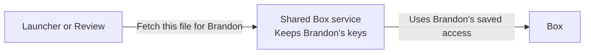

# Examples

Most of these come from real sessions where Brandon pushed back on an
explanation. Each shows the draft that failed, why it failed, and a rewrite.
The rewrites show a register to aim for. Check the facts of the actual system
before you write your own.

## A status line in private words

Brandon asked: "what does 'Integrate this commit alone; release the V2 worker
before Matching' mean?"

> Implemented locally in commit `51d742b`. Adds one bounded crop retry per
> page, with strict checks after rereading. Retains model costs, including
> failed calls. Passes 82 focused checks. Not pushed or deployed. Integrate
> this commit alone; release the V2 worker before Matching.

Every sentence needs the session's history. "Bounded crop retry," "V2 worker,"
and "Matching" are working names; "integrate," "release," and "retain" are
operations verbs; nothing says what a user would notice.

> Some annotations failed to copy because a math sign, such as ≥, read
> differently on the old and new PDFs. Now, when a match fails only on a sign,
> the pipeline crops that spot on both pages and asks the model to read each
> crop again. It copies the annotation only if the new readings agree with
> everything else on the page. On page 26, this recovers the missing footnote,
> and it still refuses to copy when the new PDF changes "≥30" to ">30".
>
> It's one local commit; nothing is live. When we deploy, the page worker goes
> first. It has to know how to record what failed model calls cost before the
> matching service starts making them.

## A principle with nothing to hold

Brandon said: "this is abstract, let's bring this back down to earth."

> An abstraction flattens the curve when it removes steps, but only if what's
> left is something the model can do reliably.

> When a notation lets the model take one step where it used to take many, the
> model stops getting worse as the problem grows. With named building blocks,
> the model changed a drawing with one edit in place of sixteen coordinate
> edits, and its accuracy held as the drawings got bigger. The one remaining
> step still has to be easy for that model. A small model given the even/odd
> shortcut had to find one even number in a long product, and it missed
> unless that number sat near the end.

## Numbers in place of the story

Brandon asked: "you haven't explained the failure in plain language, why not?"

> **The tall-page test did not pass.** Time: 6 minutes 18 seconds. Result: 16
> of 17 sections finished. Section 13 hit a separate 90-second timeout. The
> worker stayed connected beyond the old five-minute limit, so that fix worked.

> The tall page still fails, for a new reason. The pipeline cuts a tall page
> into 17 strips and sends each to the model. Sixteen came back. Strip 13 took
> longer than the 90 seconds we allow one model call, so the page never got a
> complete result. The fix we were testing works: the worker now stays
> connected past the old five-minute limit. Next I'd find out why strip 13 is
> slow before raising the limit.

## Data that skips the question

Brandon asked: "tldr how have we improved the pipeline results, in terms of
false negatives and false positives?" The draft answered with a table of time
and cost for three test calls.

> On the three test pages, the new pipeline copied all seven annotations it
> should have and added none: no missed copies, no wrong copies. We haven't run
> the old pipeline on these pages, so I can't say yet how much better that is.
> A run of the old pipeline on the same pages would answer it.

Use the reader's frame for accuracy. "Missed copies" and "wrong copies" stay
concrete where "recall" and "precision" ask for translation.

## Diagram labels that hide what happens

A sequence diagram showed a person describing a business process to a chat
model, which then sent "Read workflow" to a server. Brandon asked why "describe
a process" became "read workflow," and said what happens: the model turns the
person's description into a formal workflow, which the server saves as a JSON
definition. The arrow labels should tell that story: "describes the process,"
"turns the description into a workflow definition," "checks and saves the
definition." The same review removed a browser page and a storage box that
added nothing to the point.

## A timing picture that compares

Brandon wanted to see where a pipeline spends its time and compare two
versions. The draft had a reference table, several layers of introduction, and
two timing charts built differently. Brandon described the picture: every page
of the document as its own row, time running left to right, both versions on
the same scale. Read across a row to follow one page; read down a column to see
everything happening at one moment. The table went away.

## Reporting a change: shared Box access

Brandon explained this change aloud before anyone wrote it down. It shows the
order to follow: the problem, the change, then what happens.

> Each tool used to keep its own Box connection, and none of them held on to
> your permission well. Now one shared service keeps your Box connection, and
> the tools ask it to fetch files for you.
>
> When you click Connect Box and approve access, the service trades Box's
> approval code for two keys: one to make requests, and one to get a fresh key
> later. It saves them, encrypted, under your identity. When Review needs a
> file, it asks the service, which fetches the file with your keys.
>
> The keys never leave the service. So one place handles renewal, and the tools
> share your connection without each holding its own.

A picture for this explanation should show where the keys stay. Arrows mean
requests; the picture leaves out the approval flow and the returning file.

Renewal deserves its own explanation and its own picture. Box's renewal key
works once, so if two requests try to renew at the same moment, one fails. The
service marks renewal as underway in the saved record before it calls Box, and
other requests wait for the new key.

## A small fix

> The editor cleared your draft as soon as it sent the save. Now it clears the
> draft after the server confirms the save. If the save fails, your text stays
> in the editor so you can try again.

Three sentences give the trigger, the change, and what you'd notice. A diagram
would add nothing.
